# Relatório de testes manuais — Etapa 3

**Projeto:** Locadora de Veículos  
**Data da execução:** 03/10/2026  
**Ferramenta:** Swagger UI / OpenAPI 3.0  
**Resultado:** 35 de 35 chamadas aprovadas

## 1. Objetivo

Validar pelo Swagger todas as operações CRUD das cinco entidades, os cinco filtros com joins e o tratamento padronizado de erros. Cada chamada registrou método HTTP, URL, dados enviados, código esperado, código recebido e corpo da resposta.

## 2. Ambiente

- API ASP.NET Core 8;
- Entity Framework Core 8;
- Swagger/Swashbuckle 6.6.2;
- URL dos testes: `http://127.0.0.1:5190`;
- ambiente isolado `Testing`, com banco EF Core InMemory reiniciado antes da execução;
- configuração normal da aplicação preservada para SQL Server Express em `appsettings.json`.

O provedor em memória foi usado somente para tornar a execução das evidências reproduzível, pois o serviço Windows `MSSQL$SQLEXPRESS` estava parado e exigia privilégio administrativo. Controllers, DTOs, validações, regras e rotas são exatamente os mesmos usados com o SQL Express.

## 3. Procedimento

1. Compilar a solução.
2. Iniciar a API no ambiente `Testing`.
3. Abrir `/swagger`.
4. Criar fabricante, categoria, dois clientes, veículo e aluguel.
5. Executar leituras, atualizações e os cinco filtros.
6. testar respostas 400, 404 e 409.
7. Excluir os registros em ordem inversa para respeitar relacionamentos.
8. Conferir o corpo e o código de cada resposta.

O arquivo `executar-testes.ps1` reproduz a sequência e `resultados-testes.json` conserva os retornos obtidos.

## 4. Resultado de cada chamada

| # | Método e chamada | Retorno obtido | Resultado |
|---:|---|---|---|
| 1 | `POST /api/fabricantes` | `201`; fabricante Volkswagen, ID 1 | Aprovado |
| 2 | `POST /api/categorias-veiculo` | `201`; categoria SUV, ID 1 | Aprovado |
| 3 | `POST /api/clientes` | `201`; Maria da Silva, ID 1 | Aprovado |
| 4 | `POST /api/clientes` | `201`; João sem Locação, ID 2 | Aprovado |
| 5 | `POST /api/veiculos` | `201`; T-Cross/BRA2E19, ID 1 | Aprovado |
| 6 | `POST /api/alugueis` | `201`; aluguel aberto, ID 1 | Aprovado |
| 7 | `GET /api/fabricantes` | `200`; array contendo fabricante ID 1 | Aprovado |
| 8 | `GET /api/fabricantes/1` | `200`; objeto Volkswagen | Aprovado |
| 9 | `GET /api/categorias-veiculo` | `200`; array contendo categoria ID 1 | Aprovado |
| 10 | `GET /api/categorias-veiculo/1` | `200`; objeto SUV | Aprovado |
| 11 | `GET /api/clientes` | `200`; array com clientes IDs 1 e 2 | Aprovado |
| 12 | `GET /api/clientes/1` | `200`; objeto Maria da Silva | Aprovado |
| 13 | `GET /api/veiculos` | `200`; array com T-Cross e seus relacionamentos | Aprovado |
| 14 | `GET /api/veiculos/1` | `200`; objeto T-Cross/BRA2E19 | Aprovado |
| 15 | `GET /api/alugueis` | `200`; array com aluguel ID 1 | Aprovado |
| 16 | `GET /api/alugueis/1` | `200`; aluguel de Maria e T-Cross | Aprovado |
| 17 | `PUT /api/fabricantes/1` | `204`; nome alterado para Volkswagen Brasil | Aprovado |
| 18 | `PUT /api/categorias-veiculo/1` | `204`; nome alterado para SUV Premium | Aprovado |
| 19 | `PUT /api/clientes/1` | `204`; cliente alterado para Maria Souza | Aprovado |
| 20 | `PUT /api/veiculos/1` | `204`; modelo alterado para T-Cross Highline | Aprovado |
| 21 | `PUT /api/alugueis/1` | `204`; devolução registrada, 12.450 km e total 720,00 | Aprovado |
| 22 | `GET /api/filtros/veiculos-por-fabricante?nome=Volkswagen` | `200`; veículo ID 1 | Aprovado |
| 23 | `GET /api/filtros/veiculos-por-categoria?nome=SUV&quilometragemMaxima=50000` | `200`; veículo ID 1 | Aprovado |
| 24 | `GET /api/filtros/alugueis-por-cliente?termo=Maria` | `200`; aluguel ID 1 | Aprovado |
| 25 | `GET /api/filtros/alugueis-por-periodo?inicio=2026-10-01T00:00:00&fim=2026-10-10T00:00:00` | `200`; aluguel ID 1 | Aprovado |
| 26 | `GET /api/filtros/clientes-sem-aluguel` | `200`; cliente João, ID 2; comprova `LEFT JOIN` | Aprovado |
| 27 | `POST /api/clientes` com `{}` | `400`; `ValidationProblemDetails` com campos obrigatórios | Aprovado |
| 28 | `GET /api/fabricantes/99999` | `404`; `ProblemDetails` informando recurso inexistente | Aprovado |
| 29 | `POST /api/fabricantes` com nome duplicado | `409`; `ProblemDetails` informando conflito | Aprovado |
| 30 | `DELETE /api/alugueis/1` | `204`; sem corpo | Aprovado |
| 31 | `DELETE /api/veiculos/1` | `204`; sem corpo | Aprovado |
| 32 | `DELETE /api/clientes/2` | `204`; sem corpo | Aprovado |
| 33 | `DELETE /api/clientes/1` | `204`; sem corpo | Aprovado |
| 34 | `DELETE /api/categorias-veiculo/1` | `204`; sem corpo | Aprovado |
| 35 | `DELETE /api/fabricantes/1` | `204`; sem corpo | Aprovado |

## 5. Evidências do Swagger

### 5.1 Visão geral e todos os endpoints

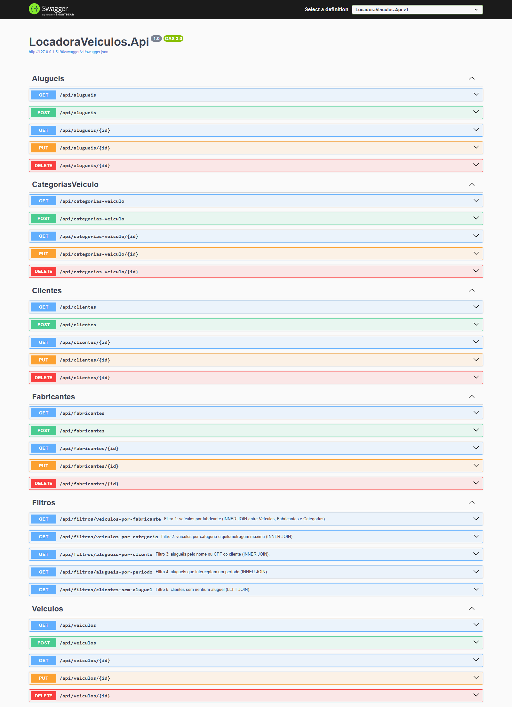

### 5.2 Método GET — retorno 200

A captura mostra chamada, Request URL, código 200 e aluguel devolvido no corpo.

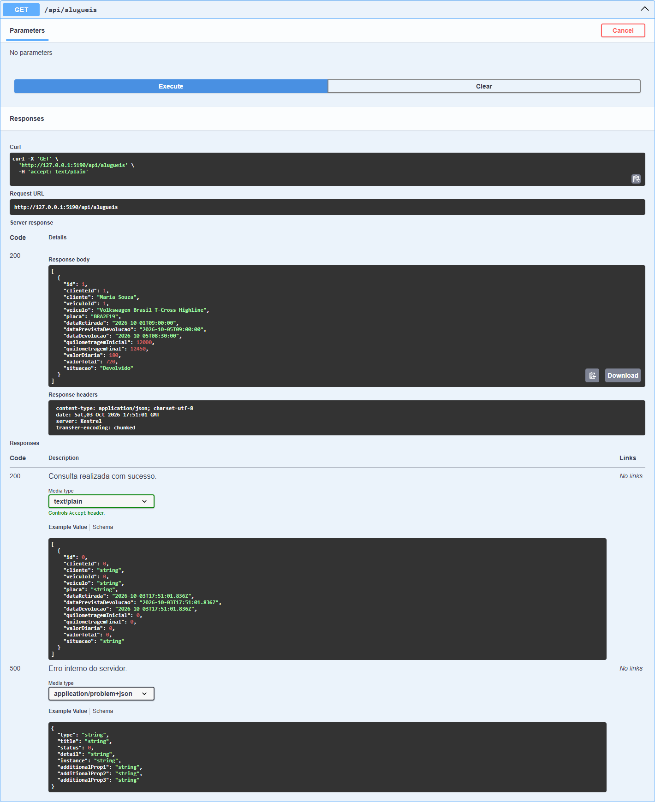

### 5.3 Método POST — retorno 201

A captura mostra o JSON enviado, comando curl gerado, URL, objeto criado e códigos documentados.

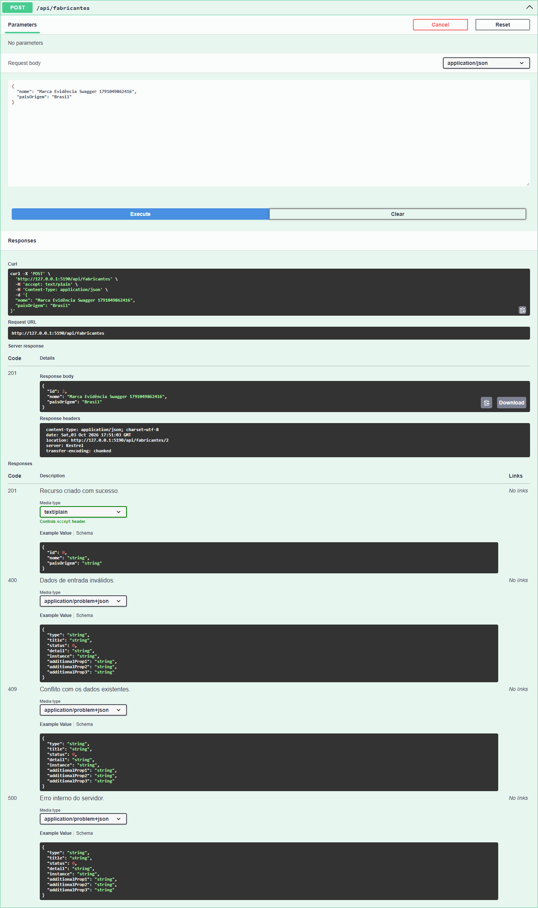

### 5.4 Método PUT — retorno 204

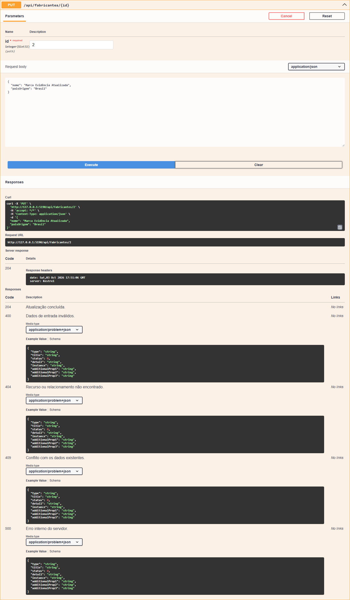

### 5.5 Método DELETE — retorno 204

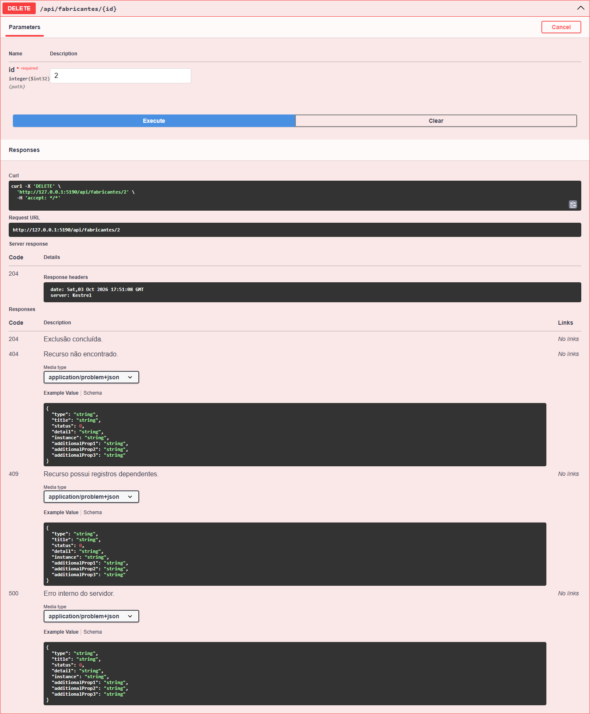

### 5.6 Validação — retorno 400

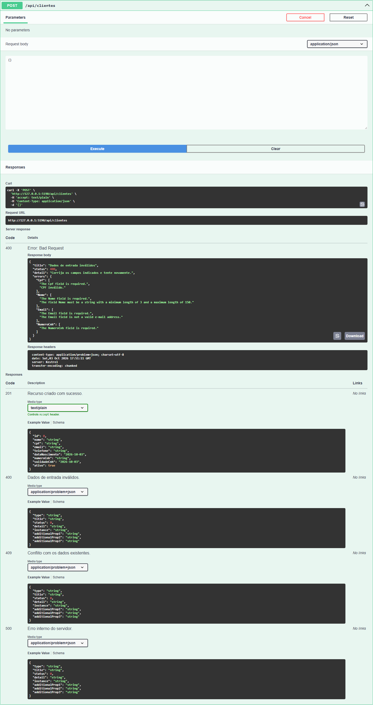

### 5.7 Recurso inexistente — retorno 404

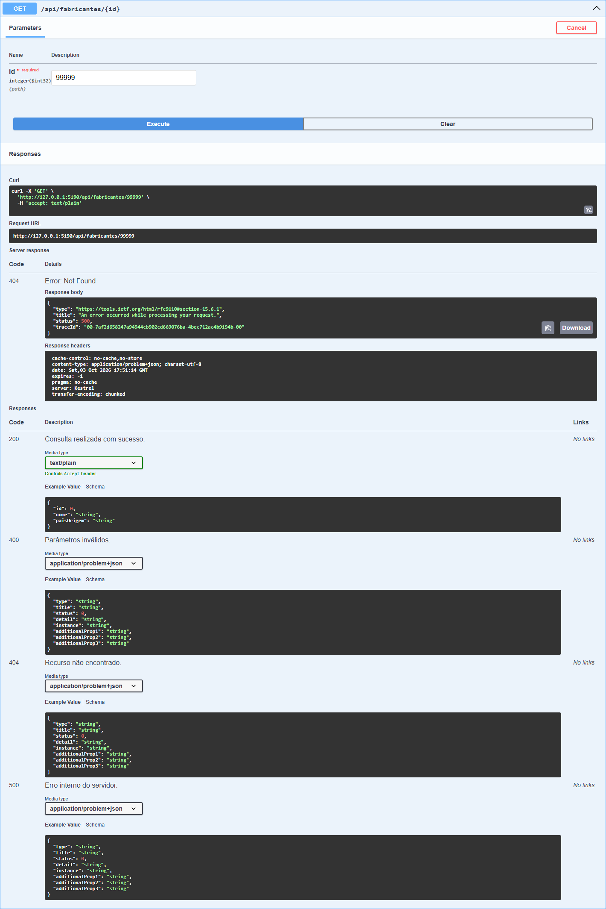

### 5.8 Duplicidade — retorno 409

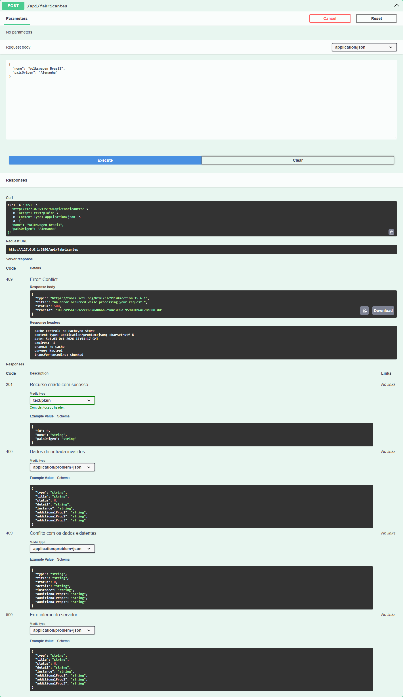

### 5.9 Filtro 1 — fabricante, INNER JOIN

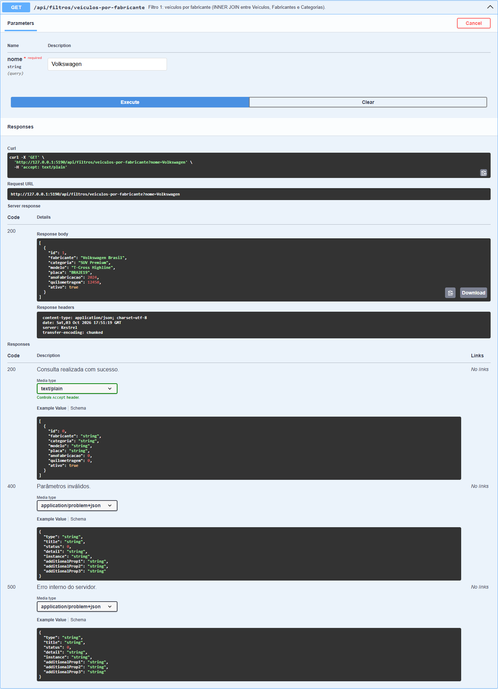

### 5.10 Filtro 2 — categoria, INNER JOIN

### 5.11 Filtro 3 — cliente, INNER JOIN

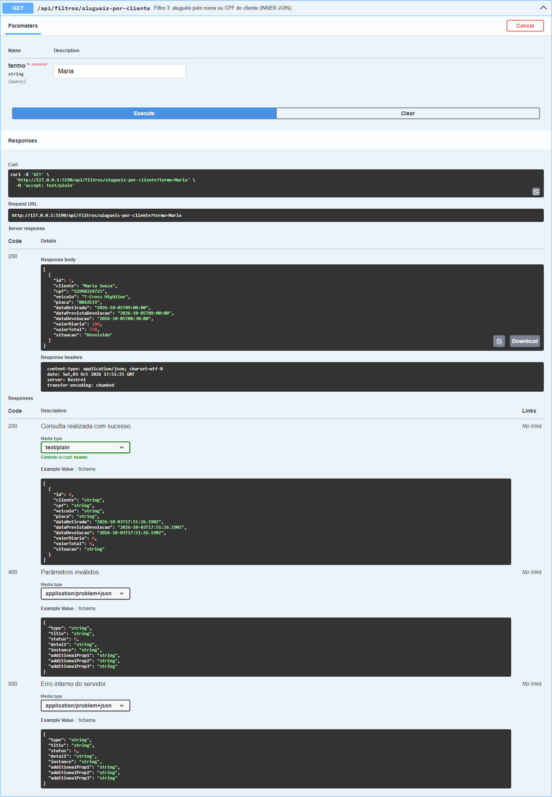

### 5.12 Filtro 4 — período, INNER JOIN

### 5.13 Filtro 5 — clientes sem aluguel, LEFT JOIN

A resposta contém o cliente João, que não possui aluguel, comprovando o resultado da junção externa.

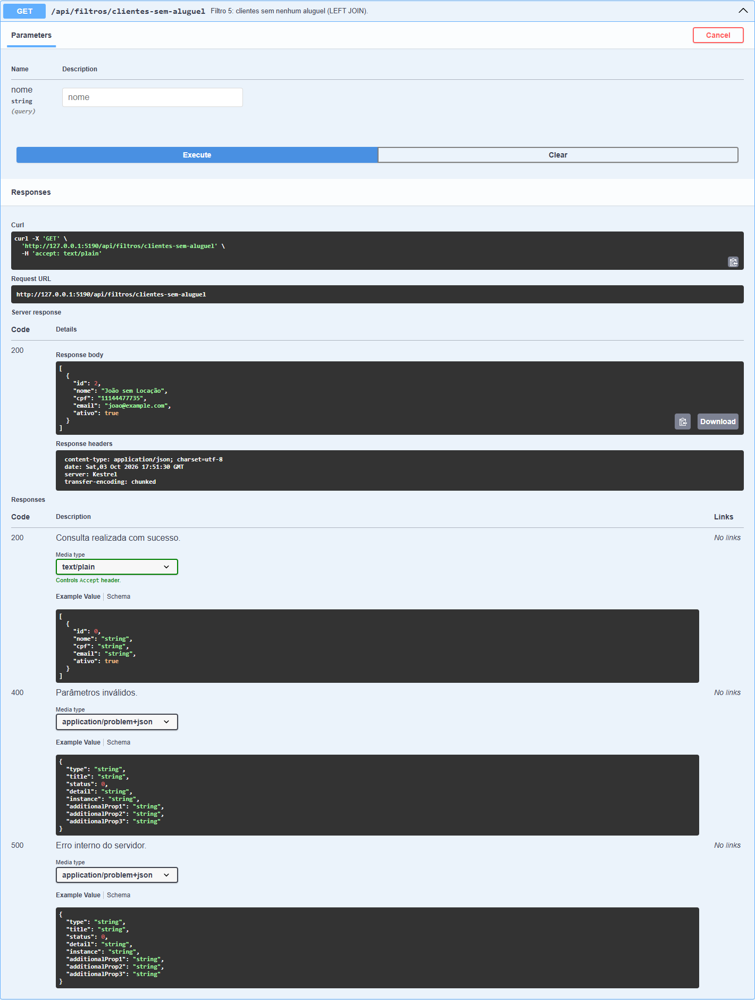

## 6. Defeito encontrado e corrigido

Na primeira execução, a validação de `ValorDiaria` dependia da conversão textual de `0.01`. Em cultura `pt-BR`, essa conversão produzia exceção e HTTP 500. A regra foi substituída por comparação decimal direta, independente de cultura. Após a correção, a bateria completa passou com 35/35 chamadas aprovadas.

## 7. Conclusão

- Swagger integrado, acessível e com os códigos de resposta documentados;
- 25 operações CRUD testadas;
- 5 filtros testados, incluindo `INNER JOIN` e `LEFT JOIN`;
- validações e tratamento 400/404/409 comprovados;
- todas as chamadas esperadas aprovadas;
- nenhuma divergência restante identificada.
