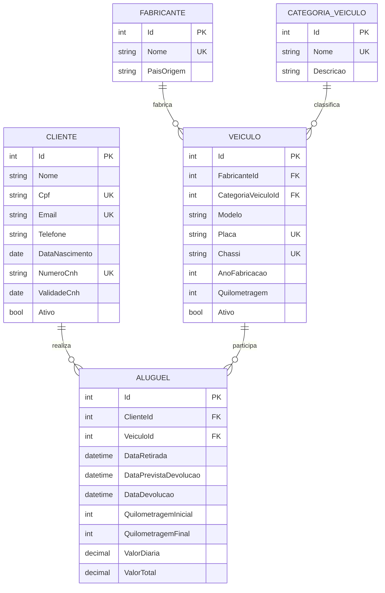

# Locadora de Veículos — Etapas 1, 2 e 3

Sistema acadêmico de locação de veículos feito com C#/.NET 8, ASP.NET Core, Entity Framework Core 8, SQL Server Express e Swagger.

## Modelo conceitual



`CategoriaVeiculo` é a quinta entidade e classifica veículos como compacto, SUV ou utilitário.

## Integridade e regras de negócio

- Relacionamentos: Fabricante 1:N Veículo, Categoria 1:N Veículo, Cliente 1:N Aluguel e Veículo 1:N Aluguel.
- Nome do fabricante, nome da categoria, placa, chassi, CPF, e-mail e CNH são únicos.
- Exclusões de registros com dependentes são bloqueadas com resposta HTTP 409.
- Ano de fabricação e quilometragens são validados; valores monetários não aceitam valores inválidos.
- Data, quilometragem final e valor total da devolução devem ser preenchidos juntos.
- Cliente e veículo precisam estar ativos, e a CNH precisa estar válida para um aluguel.
- A quilometragem inicial deve coincidir com a do veículo; ao devolver, a quilometragem do veículo é atualizada.
- Dois aluguéis do mesmo veículo não podem possuir períodos sobrepostos.
- DTOs separados controlam e validam os dados de entrada e saída sem expor as entidades diretamente.
- Erros são devolvidos no padrão `ProblemDetails`, com códigos 400, 404, 409 ou 500.

## CRUDs REST

Todas as cinco entidades possuem operações de criar, listar, consultar por ID, atualizar e excluir.

| Entidade | Rota base | Métodos |
|---|---|---|
| Fabricante | `/api/fabricantes` | GET, GET `/{id}`, POST, PUT `/{id}`, DELETE `/{id}` |
| Categoria | `/api/categorias-veiculo` | GET, GET `/{id}`, POST, PUT `/{id}`, DELETE `/{id}` |
| Cliente | `/api/clientes` | GET, GET `/{id}`, POST, PUT `/{id}`, DELETE `/{id}` |
| Veículo | `/api/veiculos` | GET, GET `/{id}`, POST, PUT `/{id}`, DELETE `/{id}` |
| Aluguel | `/api/alugueis` | GET, GET `/{id}`, POST, PUT `/{id}`, DELETE `/{id}` |

Respostas de criação usam HTTP 201; atualizações e exclusões bem-sucedidas usam HTTP 204.

## Cinco filtros com joins

| Nº | Rota | Parâmetros | Tipo de join e tabelas |
|---|---|---|---|
| 1 | `/api/filtros/veiculos-por-fabricante` | `nome` | INNER JOIN: Veículos, Fabricantes e Categorias |
| 2 | `/api/filtros/veiculos-por-categoria` | `nome`, `quilometragemMaxima` opcional | INNER JOIN: Veículos, Categorias e Fabricantes |
| 3 | `/api/filtros/alugueis-por-cliente` | `termo` (nome ou CPF) | INNER JOIN: Aluguéis, Clientes e Veículos |
| 4 | `/api/filtros/alugueis-por-periodo` | `inicio`, `fim` | INNER JOIN: Aluguéis, Clientes e Veículos |
| 5 | `/api/filtros/clientes-sem-aluguel` | `nome` opcional | LEFT JOIN: Clientes e Aluguéis |

Assim, a implementação possui cinco filtros e usa explicitamente dois tipos diferentes de junção: `INNER JOIN` e `LEFT JOIN`.

## Como preparar e executar

Pré-requisitos:

- SDK .NET 8;
- SQL Server Express com instância `SQLEXPRESS`;
- serviço `SQL Server (SQLEXPRESS)` iniciado.

Na raiz da solução, execute:

```powershell
dotnet tool restore
dotnet restore
dotnet build
dotnet tool run dotnet-ef database update --project LocadoraVeiculos.Api
dotnet run --project LocadoraVeiculos.Api
```

Depois, abra `http://localhost:5076/swagger`. Se a aplicação escolher outra porta, use o endereço exibido no terminal e acrescente `/swagger`.

A conexão está em `LocadoraVeiculos.Api/appsettings.json`. Se a instância tiver outro nome, altere `ConnectionStrings:LocadoraDb` antes de criar o banco.

## Testes manuais

O arquivo `LocadoraVeiculos.Api/LocadoraVeiculos.Api.http` contém dados válidos e requisições prontas para:

1. criar fabricante, categoria, cliente, veículo e aluguel;
2. listar os registros;
3. registrar uma devolução por `PUT`;
4. executar os cinco filtros;
5. consultar e excluir registros.

As requisições também podem ser executadas diretamente pela interface do Swagger.

## Testes e documentação — Etapa 3

Os materiais finais estão na pasta `Etapa3`:

- `DOCUMENTACAO_ENDPOINTS.pdf`: métodos, parâmetros, corpos e códigos de resposta dos 30 endpoints;
- `RELATORIO_TESTES.pdf`: relatório com 35 chamadas, resultados e capturas do Swagger;
- `evidencias/`: 13 capturas de tela originais;
- `resultados-testes.json`: retorno registrado de todas as chamadas;
- `executar-testes.ps1`: bateria reproduzível de testes;
- versões `.md` e `.html` dos documentos.

Para reproduzir a bateria no ambiente isolado de testes:

```powershell
dotnet run --project LocadoraVeiculos.Api --no-launch-profile -- --environment Testing --urls http://127.0.0.1:5190
powershell -ExecutionPolicy Bypass -File .\Etapa3\executar-testes.ps1
```

O ambiente normal permanece conectado ao SQL Server Express. O provedor em memória é ativado somente quando o ambiente `Testing` é escolhido explicitamente.

## Organização

- `Models`: entidades persistidas pelo Entity Framework;
- `Dtos`: contratos e validações de entrada e saída;
- `Controllers`: CRUDs e filtros REST;
- `Data/Configurations`: chaves, relacionamentos, índices e restrições;
- `Data/Migrations`: migração inicial do banco;
- `Infrastructure`: tratamento global de erros;
- `Validation`: validações específicas, como o CPF;
- `Etapa3`: documentação, relatório, resultados e evidências do Swagger;
- `esquema-locadora.sql`: DDL idempotente gerado pelo Entity Framework.

## Escopo entregue

A solução inclui a modelagem da Etapa 1, a implementação do backend da Etapa 2 e os testes/documentação da Etapa 3. A bateria final executou 35 chamadas com 35 aprovações e evidenciou os métodos GET, POST, PUT e DELETE, os cinco filtros e os retornos 200, 201, 204, 400, 404 e 409.
